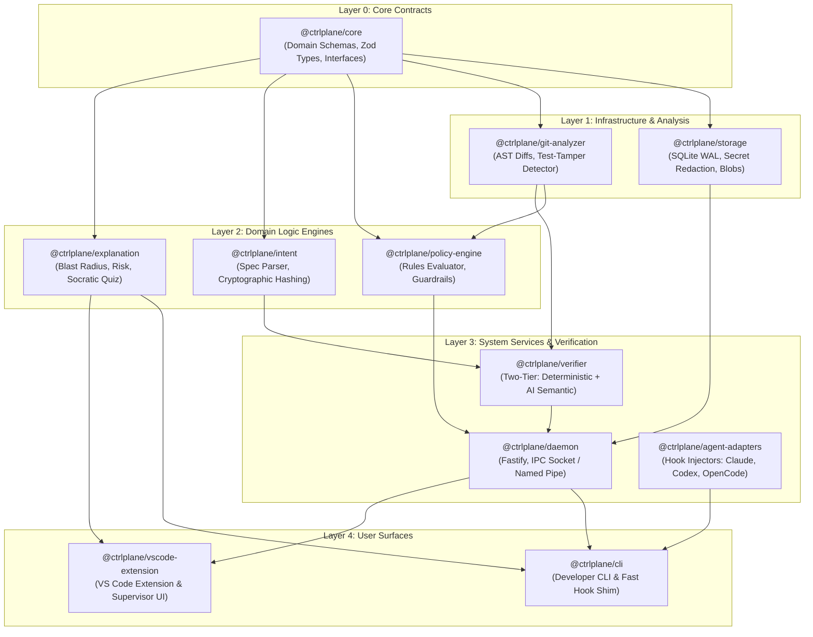

# AI Development Control Plane (`@ctrlplane`) — Implementation Plan

**Plan Status:** Awaiting Developer Manual Review & Approval  
**Target Milestone:** v0.1.0 Production-Ready CLI & Local Daemon  
**Scope:** 7 Packages, TypeScript Monorepo, Vitest Test Suite, Zero-Cloud Core  
**Prerequisite:** Feature Specifications Approved ([specs/](file:///d:/Workspace/specs/))

---

## 1. Architectural Blueprint & Dependency Graph

The project is structured as a high-performance **pnpm monorepo managed with Turborepo**. Every package maintains strict isolation, explicit type exports, and dedicated unit test suites.



---

## 2. Phase-by-Phase Implementation Plan

### Phase 0: Monorepo Foundation & Tooling Setup
* **Objective:** Establish the workspace structure, TypeScript compilation pipeline, and automated test runners.
* **Tasks:**
  1. Initialize Git repository and `.gitignore`.
  2. Create `pnpm-workspace.yaml` defining `packages/*` and `apps/*`.
  3. Configure root `package.json` with scripts for `build`, `test`, `lint`, and `typecheck`.
  4. Setup `turbo.json` with pipeline task caching.
  5. Configure `tsconfig.base.json` with modern NodeNext/ES2022 resolution and strict type checking.
  6. Configure Vitest root workspace runner.
* **Deliverable:** Working, empty monorepo where `pnpm build` and `pnpm test` execute cleanly across all packages.

---

### Phase 1: Core Domain Models & Schemas (`@ctrlplane/core`)
* **Reference Spec:** [00-overview.md](file:///d:/Workspace/specs/00-overview.md)
* **Tasks:**
  1. Define Zod schemas and TypeScript types for:
     * `Session`: status, timestamps, git base commit, agent type.
     * `Specification`: ID, version, title, plan, acceptance criteria, cryptographic hash.
     * `AcceptanceCriterion`: ID, raw text, category (`DETERMINISTIC_TESTABLE`, `SEMANTIC_BEHAVIORAL`, `NEGATIVE_INVARIANT`), completed state.
     * `AuditEvent`: sequence number, event type, tool name, inputs, outputs, timestamps.
     * `PolicyRule` & `PolicyDecision`: `ALLOW`, `DENY`, `INSTRUCT`, `REQUIRE_MANUAL_APPROVAL`.
     * `VerificationFinding`: 5-state verdict taxonomy, line citations, test evidence.
  2. Implement validation helpers and serialization/deserialization utilities.
  3. Write comprehensive unit tests for all schemas.
* **Deliverable:** Validated, zero-dependency core package published internally to the workspace.

---

### Phase 2: Storage Engine & Secret Redaction (`@ctrlplane/storage`)
* **Reference Spec:** [04-audit-trail-and-event-pipeline.md](file:///d:/Workspace/specs/04-audit-trail-and-event-pipeline.md)
* **Tasks:**
  1. Implement SQLite migration engine using `better-sqlite3` (with fallback to `libsql`).
  2. Configure SQLite with WAL mode (`PRAGMA journal_mode = WAL; PRAGMA busy_timeout = 5000;`).
  3. Implement table migrations for `sessions`, `events`, `file_snapshots`, `verification_runs`, and `verification_findings`.
  4. Implement pre-storage **Zero-Allocation Secret Scanner**:
     * Detects and redacts Anthropic (`sk-ant-`), OpenAI (`sk-proj-`), GitHub (`ghp_`), AWS (`AKIA`), and SSH private keys.
     * Scans for high-entropy environment variables.
  5. Implement compressed blob storage for tool outputs exceeding 64KB.
  6. Write concurrency, stress, and redaction unit tests.
* **Deliverable:** Battle-tested storage layer capable of sub-5ms writes with automatic credential scrubbing.

---

### Phase 3: Git Analyzer & Anti-Test-Gaming Guard (`@ctrlplane/git-analyzer`)
* **Reference Spec:** [02-agent-supervision-and-policy.md](file:///d:/Workspace/specs/02-agent-supervision-and-policy.md) & [03-independent-verification-engine.md](file:///d:/Workspace/specs/03-independent-verification-engine.md)
* **Tasks:**
  1. Build a Git diff parser extracting hunks, file paths, line additions, and deletions.
  2. Implement file path classifier: detects source files, configuration files, and test files (`**/*.test.*`, `**/*.spec.*`, `**/tests/**`).
  3. Build the **Test-Tamper Analyzer**:
     * Differentiates between *adding new test cases* (allowed) vs *deleting or modifying existing assertions* in `HEAD`.
     * Parses TypeScript/JavaScript AST to detect modifications to `expect(`, `assert`, `it(`, `test(`.
  4. Unit test suite using real Git diff fixtures simulating agent test-gaming attempts.
* **Deliverable:** Reliable AST and diff analysis package that flags unauthorized test modifications with mathematical certainty.

---

### Phase 4: Declarative Policy Engine (`@ctrlplane/policy-engine`)
* **Reference Spec:** [02-agent-supervision-and-policy.md](file:///d:/Workspace/specs/02-agent-supervision-and-policy.md)
* **Tasks:**
  1. Implement YAML policy parser reading `.ctrlplane/policies.yaml`.
  2. Implement rule evaluators for:
     * Destructive shell commands (`rm -rf`, force-push, recursive drops).
     * Sensitive credential reads (`.env`, `.pem`, `.key`, `~/.ssh`).
     * Control plane self-protection (blocking writes to `.ctrlplane/*` and `.git/*`).
     * Test-tamper rules using `@ctrlplane/git-analyzer`.
  3. Implement decision engine emitting `ALLOW`, `DENY` (with structured exit code 2 stderr), `INSTRUCT`, or `REQUIRE_MANUAL_APPROVAL`.
  4. Benchmark rule evaluation to verify $< 5\text{ms}$ execution latency.
* **Deliverable:** High-speed policy evaluator with built-in security and architectural guardrails.

---

### Phase 5: Low-Latency IPC & Supervisor Daemon (`@ctrlplane/daemon`)
* **Reference Spec:** [04-audit-trail-and-event-pipeline.md](file:///d:/Workspace/specs/04-audit-trail-and-event-pipeline.md) & [06-core-daemon-and-cli.md](file:///d:/Workspace/specs/06-core-daemon-and-cli.md)
* **Tasks:**
  1. Implement cross-platform local IPC server:
     * UNIX Domain Socket on macOS/Linux (`/tmp/ctrlplane-<pid>.sock`).
     * Named Pipe on Windows (`\\.\pipe\ctrlplane-<pid>`).
  2. Implement in-memory ring buffer for immediate synchronous hook ACKs ($< 10\text{ms}$).
  3. Implement background batch writer draining events into `@ctrlplane/storage`.
  4. Implement daemon lifecycle manager (PID lock file in `.ctrlplane/daemon.lock`, background auto-spawning, graceful teardown).
  5. Add health check endpoint and session state tracker.
* **Deliverable:** Robust local background daemon managing IPC connections and database persistence.

---

### Phase 6: Agent Adapters & Fast Hook Shim (`@ctrlplane/agent-adapters`)
* **Reference Spec:** [06-core-daemon-and-cli.md](file:///d:/Workspace/specs/06-core-daemon-and-cli.md)
* **Tasks:**
  1. Build lightweight `ctrlplane-hook` entrypoint:
     * Zero heavy dependencies; starts in $< 10\text{ms}$.
     * Streams stdin JSON payload to daemon via local IPC.
     * Evaluates response: maps `DENY` to Exit Code 2 with stderr; maps `ALLOW` to Exit Code 0.
     * Implements fail-open in dev mode on daemon timeout ($> 50\text{ms}$); fail-close in CI mode.
  2. Build non-destructive configuration injectors:
     * **Claude Code:** Reads `.claude/settings.json`, appends hooks to `PreToolUse`, `PostToolUse`, `Stop`, `UserPromptSubmit`, preserves backups.
     * **OpenAI Codex CLI:** Updates `.codex/hooks.json`.
     * **OpenCode:** Injects plugin registration in `opencode.json`.
* **Deliverable:** Drop-in hook bridge connecting Claude Code, Codex, and OpenCode to the control plane.

---

### Phase 7: Intent Management Engine (`@ctrlplane/intent`)
* **Reference Spec:** [01-intent-management.md](file:///d:/Workspace/specs/01-intent-management.md)
* **Tasks:**
  1. Build Markdown parser for `.ctrlplane/spec.md`:
     * Extracts YAML frontmatter, plan steps, and `- [ ]` checklist acceptance criteria.
     * Auto-assigns sequential IDs (`AC-1`, `AC-2`) if missing.
  2. Implement cryptographic SHA-256 specification hashing (normalized whitespace).
  3. Implement approval workflow:
     * Records developer identity, approval timestamp, and base Git commit SHA.
     * Emits version change events when specs are modified mid-session.
* **Deliverable:** Intent tracking engine anchoring agent execution to verifiable criteria.

---

### Phase 8: Two-Tier Verification Engine (`@ctrlplane/verifier`)
* **Reference Spec:** [03-independent-verification-engine.md](file:///d:/Workspace/specs/03-independent-verification-engine.md)
* **Tasks:**
  1. Implement **Tier 1 (Deterministic Runner)**:
     * Auto-detects and runs project compiler (`tsc --noEmit`, etc.).
     * Runs project test suite (`vitest run`, `npm test`, `pytest`).
     * Executes test-tamper check via `@ctrlplane/git-analyzer`.
     * Fails immediately if existing test assertions were weakened.
  2. Implement **Tier 2 (AI Semantic Auditor)**:
     * Formats criteria and Git diff into an evidence-extraction prompt.
     * Enforces mandatory line citation: criteria cannot be marked `SEMANTIC_VERIFIED` without exact file, start line, and end line.
     * Maps findings into the 5-state verdict taxonomy (`DETERMINISTIC_PASS`, `SEMANTIC_VERIFIED`, `DISCREPANCY`, `UNCHECKED`, `INCONCLUSIVE`).
  3. Build unified report generator (terminal ASCII table and structured JSON).
* **Deliverable:** Independent verification engine eliminating false confidence and test-cheating.

---

### Phase 9: Code Explanation & Developer Learning (`@ctrlplane/explanation`)
* **Reference Spec:** [05-code-explanation-and-learning.md](file:///d:/Workspace/specs/05-code-explanation-and-learning.md)
* **Tasks:**
  1. Build AST symbol reference tracer computing the blast radius of modified functions and exports.
  2. Build dependency drift auditor inspecting `package.json` for new third-party additions.
  3. Implement Socratic comprehension quiz generator ("Grill Me" mode) generating targeted questions about edge cases.
  4. Enforce anti-hallucination rules (explanations ground strictly in observable diffs).
* **Deliverable:** Delta-focused explanation module giving developers instant insight into changeset risks.

---

### Phase 10: Unified CLI & End-to-End Integration Tests (`@ctrlplane/cli`)
* **Reference Spec:** [06-core-daemon-and-cli.md](file:///d:/Workspace/specs/06-core-daemon-and-cli.md)
* **Tasks:**
  1. Wire all subcommands in the `ctrlplane` CLI:
     * `init`: Project bootstrapping & hook injection.
     * `start` / `stop` / `status`: Daemon management.
     * `spec new` / `spec approve`: Intent tracking.
     * `verify`: Tier 1 & Tier 2 verification report.
     * `explain`: Blast radius & risk report.
     * `audit list` / `audit show` / `audit export`: Forensics & replay.
     * `hook`: Internal hook shim entrypoint.
  2. Build comprehensive End-to-End Integration Test Suite:
     * Simulate Claude Code hook execution on a real Git repository.
     * Test destructive command blocking (`rm -rf`).
     * Test test-tampering detection when an agent alters assertions.
     * Test full intent $\rightarrow$ execution $\rightarrow$ verification cycle.
* **Deliverable:** Fully functional, standalone developer CLI ready for production usage.

---

## 3. Milestones & Checkpoint Gates

```
[ Phase 0 & 1 ] ──▶ Checkpoint A: Monorepo Foundation & Core Schemas Validated
       │
[ Phase 2 & 3 ] ──▶ Checkpoint B: SQLite WAL Storage & Anti-Test-Gaming Guard
       │
[ Phase 4 & 5 ] ──▶ Checkpoint C: Policy Engine & Low-Latency IPC Daemon
       │
[ Phase 6 & 7 ] ──▶ Checkpoint D: Agent Adapters & Intent Management
       │
[ Phase 8 & 9 ] ──▶ Checkpoint E: Two-Tier Verifier & Delta Explanation
       │
[ Phase 10    ] ──▶ Final Milestone: Unified CLI & End-to-End Test Suite Passing
```

---

## 4. Acceptance Criteria for Complete Implementation

- [ ] **E2E-1:** `ctrlplane init` successfully installs hooks in a project without breaking existing configurations.
- [ ] **E2E-2:** Simulated agent attempting to execute `rm -rf /` or modify `.env` is blocked with Exit Code 2.
- [ ] **E2E-3:** Simulated agent attempting to delete assertions in an existing test file is blocked or flagged as a test-tamper violation.
- [ ] **E2E-4:** `ctrlplane verify` accurately runs local test suites and compiles a 5-state acceptance criteria report.
- [ ] **E2E-5:** Complete session events are sanitized of API keys and retrievable via `ctrlplane audit show`.
- [ ] **E2E-6:** The entire test suite passes with 100% clean exit codes across all packages.

