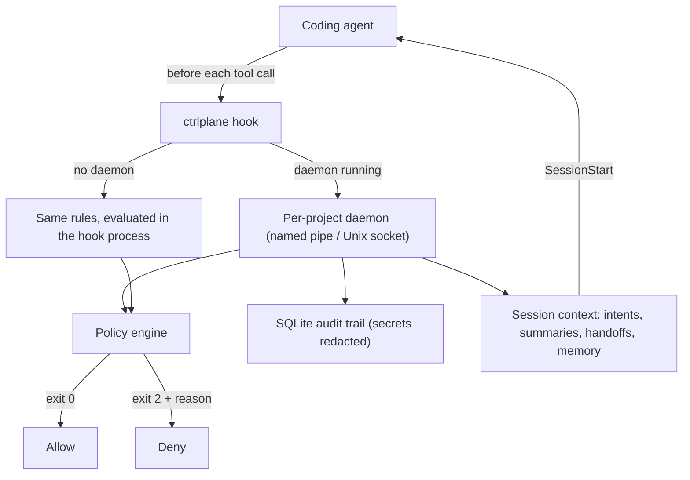

# AgentDock CLI (`ctrlplane`)

> A local supervisor for AI coding agents. It checks every tool call before it runs, keeps an audit trail, and gives each new session the context the last one left behind.

[](https://github.com/ankit-tiwari-dev/agentdock-cli/actions/workflows/ci.yml)
[](https://nodejs.org)

AgentDock hooks into Claude Code, OpenAI Codex and OpenCode. Before the agent runs a tool, the hook asks AgentDock, and AgentDock answers in one of four ways: allow, deny with a reason the agent can read, ask the human, or allow with an instruction. Everything runs on your machine, and nothing is sent anywhere.

## How it works



Package layout, state paths and the full request flow: [`docs/ARCHITECTURE.md`](docs/ARCHITECTURE.md).

## What it does

- **Guards destructive and risky commands.** It blocks recursive deletes, force pushes, hard resets and reads of credential files (`.env`, `*.pem`, `~/.ssh`), and offers 25 more rules you can switch on, off or to observe-only.
- **Stops agents switching supervision off.** Edits to the agent's own hook settings, and commands that stop, pause, weaken or uninstall AgentDock, are denied.
- **Protects tests.** Changes that delete or weaken existing test assertions are blocked.
- **Breaks loops.** When the same command fails the same way three times in a row, the next call needs human approval.
- **Carries context between sessions.** It records what you asked for, summarises each session, and keeps handoff notes and project memory. A new session then starts with a short context pack.
- **Verifies against a spec.** It runs deterministic checks plus an audit of each acceptance criterion in `.ctrlplane/spec.md`, which needs file-and-line evidence.
- **Explains a diff.** It shows changed symbols, blast radius, dependency changes and a short comprehension quiz.
- **Tracks cost.** It shows token and dollar cost per turn from local Claude Code transcripts, a per-turn commit with metadata trailers, and a prompt-quality coach.

## Quickstart

Requires Node 22.18 or newer (Node 24 recommended). There is no build step, because Node runs the TypeScript sources directly.

```bash
npm ci

# In the project you want supervised:
node packages/cli/src/bin.ts init --agent claude   # claude | codex | opencode | all
node packages/cli/src/bin.ts start                 # optional daemon: faster hooks, fuller audit trail
node packages/cli/src/bin.ts status
```

`init` creates `.ctrlplane/spec.md` and adds the hooks to the agent's settings without touching your other hooks.

### Everyday commands

```bash
ctrlplane policies list                        # every rule and its mode
ctrlplane policies test --command "git push --force" --expect deny
ctrlplane pause 30m                            # always-on rules still apply
ctrlplane context                              # what a new session will be told
ctrlplane handoff --note "auth done, refresh tokens next"
ctrlplane memory add "integration tests need docker" --pin
ctrlplane spec approve "<your name>"
ctrlplane verify
ctrlplane explain
ctrlplane audit list
ctrlplane backtrace                            # turns, tokens and cost from local transcripts
ctrlplane cost claude-sonnet-4-5 15000 2500
```

Run `ctrlplane help` for the full list. Until the CLI is installed globally, use `node packages/cli/src/bin.ts` in place of `ctrlplane`.

## Development

```bash
make ci          # every gate CI runs
make lint        # ESLint + Prettier check
make hygiene     # repo rules
make typecheck
make test
```

### Develop in a dev container

`.devcontainer/` holds the environment CI uses: Node 24, Go 1.27 (for actionlint, gitleaks and osv-scanner), make and git, with the images pinned by digest. In VS Code, run **Dev Containers: Reopen in Container**; it installs the dependencies with `npm ci`. On Windows and macOS, **Dev Containers: Clone Repository in Container Volume** is much faster than opening a local folder, because `node_modules` then lives inside Docker instead of on a shared folder.

`make devcontainer-check` builds that image and runs `make ci` and actionlint in it, as CI does on every pull request. Run it from a normal clone, not a `git worktree`.

The dev container is for working on the CLI. Use the CLI itself on your machine, where the agent's hooks call it ([`docs/DECISIONS.md`](docs/DECISIONS.md) → D-11).

Rules for changing the code: [`CLAUDE.md`](CLAUDE.md). Known traps: [`docs/PITFALLS.md`](docs/PITFALLS.md). Known bugs: [`ISSUE.md`](ISSUE.md).

## License

No license has been chosen yet (`ISSUE.md` → I-7).
