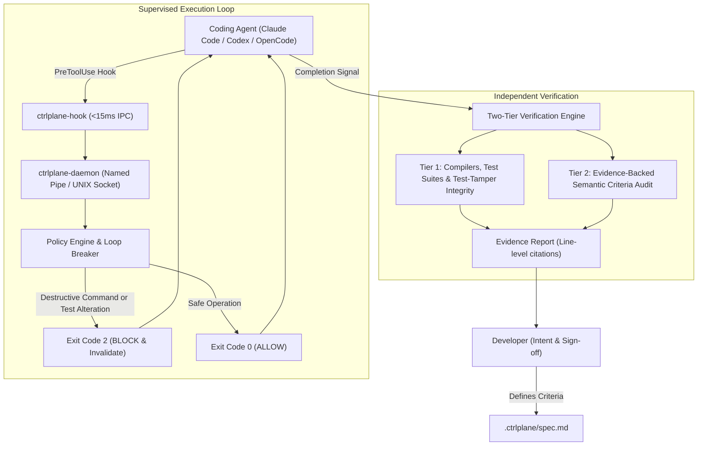

# AgentDock CLI (`@ctrlplane`)

> **The local-first supervision, verification, and auditability control plane for AI coding agents.**

[](https://github.com/ankit-tiwari-dev/agentdock-cli)
[](https://nodejs.org)
[](LICENSE)

**AgentDock CLI** (`ctrlplane`) is an open-source, local-first supervision layer that connects developer intent, coding agent activity (Claude Code, OpenAI Codex, OpenCode), and independent verification. 

It prevents autonomous AI agents from hallucinating completion, deleting existing test suites to "fix" bugs, running destructive commands, or getting stuck in expensive token loops.

---

## Architecture Overview



---

## Key Capabilities

* **Anti-Test-Gaming Guard:** Agents frequently "fix" broken code by deleting or weakening existing test assertions. AgentDock intercepts tool calls targeting test files and blocks alterations to existing assertions with `Exit Code 2`.
* **Destructive Command Guard:** Blocks `rm -rf`, `git push --force`, `git reset --hard`, recursive deletions, and private credential reads (`.env`, `.pem`, `~/.ssh`).
* **Loop Breaker (Circuit Breaker):** Automatically detects when an agent fails the same test or command 3 consecutive times, halting the agent to prevent runaway token spend.
* **Two-Tier Verification:** Never trusts an agent's self-reported "Done" signal.
  * **Tier 1 (Deterministic):** Compilers, typecheckers, test runners, and AST test-tamper analyzers.
  * **Tier 2 (Semantic):** Maps acceptance criteria against code diffs and requires exact file, start line, and end line citations.
* **Sub-15ms Latency Budget:** Lightweight hook shim connects to the daemon over Windows Named Pipes or UNIX domain sockets, acknowledging calls in $< 10\text{ms}$.
* **Zero-Allocation Secret Redaction:** Strips Anthropic keys, OpenAI keys, GitHub tokens, AWS credentials, and `.env` secrets prior to SQLite disk persistence.

---

## Monorepo Packages

| Package | Description |
|---|---|
| [`@ctrlplane/core`](packages/core/) | Shared domain contracts, Zod schemas, and deterministic spec hashing. |
| [`@ctrlplane/storage`](packages/storage/) | SQLite WAL database engine via `node:sqlite` and pre-storage secret redactor. |
| [`@ctrlplane/git-analyzer`](packages/git-analyzer/) | AST unified diff parser, file classifier, and Anti-Test-Gaming guard. |
| [`@ctrlplane/policy-engine`](packages/policy-engine/) | Declarative safety rules, regex guards, and 3-strike Loop Breaker. |
| [`@ctrlplane/daemon`](packages/daemon/) | Windows Named Pipe (`\\.\pipe\ctrlplane-*`) & UNIX socket IPC daemon. |
| [`@ctrlplane/agent-adapters`](packages/agent-adapters/) | Non-destructive hook injectors for Claude Code, Codex, and OpenCode. |
| [`@ctrlplane/intent`](packages/intent/) | Markdown specification parser (`.ctrlplane/spec.md`) and criteria tracker. |
| [`@ctrlplane/verifier`](packages/verifier/) | Two-tier verification runner and 5-state verdict reporter. |
| [`@ctrlplane/explanation`](packages/explanation/) | Blast radius tracer, dependency drift auditor, and Socratic quiz generator. |
| [`@ctrlplane/cli`](packages/cli/) | The developer command-line interface (`ctrlplane`). |

---

## Quickstart

### 1. Initialize a Project
Run inside any Git repository:

```bash
# Initialize .ctrlplane templates and inject hooks into Claude Code / Codex
node packages/cli/src/bin.ts init
```

This creates `.ctrlplane/spec.md`, `.ctrlplane/policies.yaml`, and non-destructively wires hooks into `.claude/settings.json` or `.codex/hooks.json`.

### 2. View and Approve Specification
```bash
# View active criteria
node packages/cli/src/bin.ts spec show

# Approve specification and lock baseline commit
node packages/cli/src/bin.ts spec approve "ankit"
```

### 3. Start the Supervisor Daemon
```bash
# Starts the background supervisor daemon
node packages/cli/src/bin.ts start

# Check status and IPC endpoint
node packages/cli/src/bin.ts status
```

### 4. Run Independent Verification
```bash
node packages/cli/src/bin.ts verify
```

### 5. Inspect Code Blast Radius & Delta Explanation
```bash
node packages/cli/src/bin.ts explain
```

---

## Automated Test Suite

Run the complete test suite across all 10 packages:

```bash
node --test packages/*/tests/**/*.test.ts
```

Output:
```
✔ 29/29 tests passing (Duration: ~3.1s)
```

---

## License

MIT © [Ankit Tiwari](https://github.com/ankit-tiwari-dev)
