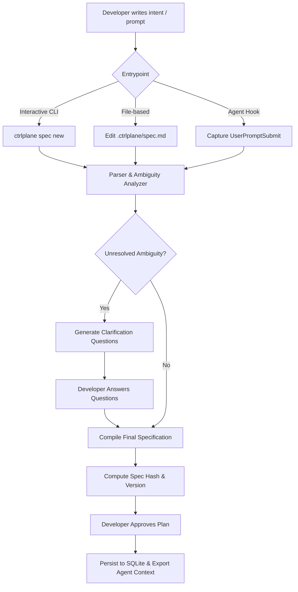

# Feature Specification: Intent Management

**Module ID:** `SPEC-01-INTENT`  
**Package:** `@ctrlplane/core`, `@ctrlplane/intent`  
**Status:** Ready for Review

---

## 1. Objective & Scope

The Intent Management module captures developer requirements, converts informal goals into unambiguous, testable acceptance criteria, tracks specification versions across session iterations, and records explicit developer sign-offs. It ensures the coding agent is anchored to a defined scope before execution begins.

---

## 2. User Workflows



---

## 3. Functional Requirements

### 3.1 Specification File Format (`.ctrlplane/spec.md`)
The system must support a standard Markdown format with structured YAML frontmatter and checklist-based acceptance criteria:

```markdown
---
id: SPEC-2026-11-AUTH
title: Add JWT Authentication & Refresh Token Rotation
version: 1
author: developer
status: approved
created_at: 2026-11-10T18:00:00Z
hash: sha256-a1b2c3d4...
---

# Feature Overview
Implement secure JWT authentication with short-lived access tokens (15m) and persistent refresh tokens stored in HTTP-only cookies with automatic rotation.

## Implementation Plan
1. Create database schema for refresh tokens (`token`, `user_id`, `expires_at`, `revoked`).
2. Add auth middleware in `src/middleware/auth.ts`.
3. Implement `/api/auth/login`, `/api/auth/refresh`, `/api/auth/logout`.
4. Add comprehensive integration tests verifying rotation and replay detection.

## Acceptance Criteria
- [ ] AC-1: POST /api/auth/login returns 200 with access token in body and refresh token in HttpOnly cookie.
- [ ] AC-2: Access token expires after 15 minutes.
- [ ] AC-3: POST /api/auth/refresh invalidates the old refresh token and issues a new token pair.
- [ ] AC-4: Attempting to reuse an invalidated refresh token revokes all active sessions for that user.
- [ ] AC-5: Existing unit and integration tests remain intact and passing.
```

### 3.2 Criteria Parsing Engine
* **Parser Rules:**
  * Extracts any `- [ ]` or `- [x]` markdown checklist item under a `## Acceptance Criteria` section.
  * Assigns an immutable ID (e.g., `AC-1`, `AC-2`) based on explicit prefix or sequential line order.
  * Classifies criteria into:
    * `DETERMINISTIC_TESTABLE`: Quantifiable assertions (e.g., status codes, return types, timeouts).
    * `SEMANTIC_BEHAVIORAL`: Architectural or UX requirements requiring code inspection.
    * `NEGATIVE_INVARIANT`: "Must not" constraints (e.g., "Must not store secrets in plaintext").

### 3.3 Ambiguity Analysis & Clarification
* If a prompt or spec lacks concrete criteria (e.g., "Make auth better"), the module triggers an ambiguity analysis using a local or configured model.
* Generates 1–3 targeted clarification questions (multiple choice or short answer).
* Answers are folded into the specification before execution begins.

### 3.4 Versioning & Immutability
* Each specification revision calculates a cryptographic SHA-256 hash of its normalized content (stripped of trailing whitespace and comments).
* If a developer or agent edits `.ctrlplane/spec.md` mid-session, the system creates a new version (`version: 2`) and logs a `SPEC_VERSION_CHANGED` event in the audit trail.
* Any active verification report is locked to the specific `spec_hash` it was executed against.

---

## 4. Data Models & TypeScript Schemas

```typescript
import { z } from "zod";

export const CriterionTypeSchema = z.enum([
  "DETERMINISTIC_TESTABLE",
  "SEMANTIC_BEHAVIORAL",
  "NEGATIVE_INVARIANT",
]);

export const AcceptanceCriterionSchema = z.object({
  id: z.string(), // e.g. "AC-1"
  rawText: z.string(),
  description: z.string(),
  type: CriterionTypeSchema,
  completed: z.boolean().default(false),
});

export const SpecificationSchema = z.object({
  id: z.string(),
  sessionId: z.string(),
  version: z.number().int().positive(),
  title: z.string(),
  overview: z.string(),
  plan: z.array(z.string()),
  acceptanceCriteria: z.array(AcceptanceCriterionSchema),
  hash: z.string(), // SHA-256
  status: z.enum(["draft", "awaiting_approval", "approved", "superseded"]),
  approvedBy: z.string().optional(),
  approvedAt: z.number().int().optional(),
  createdAt: z.number().int(),
});

export type Specification = z.infer<typeof SpecificationSchema>;
export type AcceptanceCriterion = z.infer<typeof AcceptanceCriterionSchema>;
```

---

## 5. Failure Modes & Edge Cases

1. **Unformatted Spec File:** If the developer writes freeform text without `- [ ]` checkboxes, the parser falls back to treating each numbered list item or bullet point as a criterion, flagging `type: SEMANTIC_BEHAVIORAL` with an informational notice.
2. **Mid-Session Spec Deletion:** If `.ctrlplane/spec.md` is deleted while an agent is running, the daemon preserves the last approved specification in memory and SQLite, raising a high-priority policy alert.
3. **Circular Version Updates:** If an agent attempts to edit `.ctrlplane/spec.md` to remove a requirement it failed to satisfy, the agent supervision policy (SPEC-02) **blocks the edit immediately**.

---

## 6. Acceptance Criteria

- [ ] **AC-INTENT-1:** The parser correctly extracts frontmatter, plan steps, and acceptance criteria from `.ctrlplane/spec.md`.
- [ ] **AC-INTENT-2:** Modifying any character of the specification content results in a different calculated SHA-256 hash.
- [ ] **AC-INTENT-3:** The parser automatically assigns sequential IDs (`AC-1`, `AC-2`) if explicit IDs are omitted by the user.
- [ ] **AC-INTENT-4:** The specification approval command (`ctrlplane spec approve`) stamps developer identity, current Git commit SHA, and timestamp into the SQLite database.

