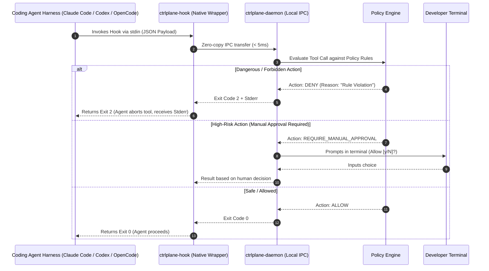

# Feature Specification: Agent Supervision & Policy Engine

**Module ID:** `SPEC-02-POLICY`  
**Package:** `@ctrlplane/policy-engine`, `@ctrlplane/agent-adapters`  
**Status:** Ready for Review

---

## 1. Objective & Scope

The Agent Supervision & Policy Engine intercepts coding agent activity in real time, inspects planned tool calls *before* execution, enforces declarative safety and architectural guardrails, and provides immediate steering feedback when an agent deviates from the approved plan or attempts dangerous actions.

A primary responsibility of this module is the **Test-Integrity & Anti-Regression Guard**, which prevents AI agents from modifying or weakening existing test assertions to artificially make failing test suites pass.

---

## 2. Architecture & Interception Flow



---

## 3. Functional Requirements

### 3.1 Synchronous Hook Contract
The engine must integrate natively with supported agent hook interfaces:
* **Claude Code:** Registered in `.claude/settings.json` under `PreToolUse`, `PostToolUse`, `Stop`, and `UserPromptSubmit`.
  * Exit `0`: Allow.
  * Exit `2`: Deny / Block. Output on `stderr` is passed back to Claude Code as the rejection reason.
* **OpenAI Codex CLI:** Registered in `.codex/hooks.json`.
  * Returns JSON payload on stdout: `{"decision": "allow" | "block", "reason": "..."}`.
* **OpenCode:** Registered via `@opencode-ai/plugin` (`tool.execute.before`).

### 3.2 Policy Rules Configuration (`.ctrlplane/policies.yaml`)
Rules are expressed declaratively in human-readable YAML:

```yaml
version: "1.0"
settings:
  default_action: "ALLOW"
  enforce_test_integrity: true
  max_unsupervised_tool_calls: 30

rules:
  - id: "RULE-BLOCK-TEST-TAMPER"
    name: "Protect Existing Test Assertions"
    description: "Blocks modification or deletion of existing test files without explicit approval."
    event: "PreToolUse"
    target_tools: ["Edit", "Write"]
    file_patterns:
      - "**/*.test.{ts,js,py,go}"
      - "**/*.spec.{ts,js,py,go}"
      - "**/tests/**"
    conditions:
      - type: "EXISTING_FILE_MODIFIED" # Adding a brand new test file is permitted
    action: "REQUIRE_MANUAL_APPROVAL"
    message: "Policy Warning: Attempting to modify existing test file. Agents must fix source code, not modify test assertions."

  - id: "RULE-PROTECT-CTRLPLANE-CONFIG"
    name: "Protect Control Plane Invariants"
    event: "PreToolUse"
    target_tools: ["Edit", "Write", "Bash"]
    file_patterns:
      - ".ctrlplane/**"
      - ".git/**"
    action: "DENY"
    message: "Access Denied: AI agents are strictly forbidden from modifying control plane configuration, specs, or Git internals."

  - id: "RULE-BLOCK-DESTRUCTIVE-SHELL"
    name: "Block Destructive Shell Commands"
    event: "PreToolUse"
    target_tools: ["Bash"]
    command_patterns:
      - "^rm\\s+-[rf]{1,2}\\s+.*"
      - "^git\\s+push\\s+.*--force.*"
      - "^git\\s+reset\\s+--hard.*"
      - ".*DROP\\s+TABLE.*"
    action: "DENY"
    message: "Destructive command blocked by safety policy. Use targeted, non-destructive operations."

  - id: "RULE-PREVENT-SECRET-EXFILTRATION"
    name: "Block Sensitive File Reads"
    event: "PreToolUse"
    target_tools: ["Read", "Bash"]
    file_patterns:
      - "**/.env*"
      - "**/*.pem"
      - "**/*.key"
      - "~/.ssh/**"
    action: "DENY"
    message: "Security Policy: Reading private credentials or environment files is prohibited."
```

### 3.3 The Anti-Test-Gaming Engine
When an agent invokes `Edit` or `Write` on a test file:
1. The engine checks Git status:
   * **New Test File:** Allowed immediately (encourages agents to write new tests for new features).
   * **Existing Test File:**
     * The engine diffs the planned change against the current Git index (`HEAD`).
     * If the diff deletes assertions (`expect(`, `assert`, `test(`, `it(`) or weakens thresholds, the tool call is **BLOCKED (Exit 2)** or flagged for **MANDATORY_MANUAL_APPROVAL**.
     * The feedback message specifically instructs: *"You attempted to alter an existing test assertion. Solve the problem by fixing the implementation code in src/, do not weaken the test."*

### 3.4 Steering Instructions (`INSTRUCT` Action)
If a tool call is safe to run but violates an architectural guideline (e.g. creating a utility file in the wrong folder), the policy engine allows execution (`Exit 0`) but appends corrective steering text into the session context to guide subsequent turns.

---

## 4. Data Models & TypeScript Schemas

```typescript
import { z } from "zod";

export const PolicyActionSchema = z.enum([
  "ALLOW",
  "DENY",
  "INSTRUCT",
  "REQUIRE_MANUAL_APPROVAL",
]);

export const PolicyConditionSchema = z.object({
  type: z.enum([
    "EXISTING_FILE_MODIFIED",
    "DELETION_OF_ASSERTIONS",
    "REGEX_COMMAND_MATCH",
    "PATH_GLOB_MATCH",
    "AST_PATTERN_MATCH",
  ]),
  pattern: z.string().optional(),
  inverted: z.boolean().default(false),
});

export const PolicyRuleSchema = z.object({
  id: z.string(),
  name: z.string(),
  description: z.string().optional(),
  event: z.enum(["PreToolUse", "PostToolUse", "UserPromptSubmit", "Stop"]),
  targetTools: z.array(z.string()).default(["*"]),
  filePatterns: z.array(z.string()).optional(),
  commandPatterns: z.array(z.string()).optional(),
  conditions: z.array(PolicyConditionSchema).optional(),
  action: PolicyActionSchema,
  message: z.string(),
});

export const PolicyEvaluationResultSchema = z.object({
  decision: PolicyActionSchema,
  matchedRuleId: z.string().optional(),
  reason: z.string(),
  steeringInstruction: z.string().optional(),
  latencyMs: z.number(),
});

export type PolicyRule = z.infer<typeof PolicyRuleSchema>;
export type PolicyEvaluationResult = z.infer<typeof PolicyEvaluationResultSchema>;
```

---

## 5. Failure Modes & Edge Cases

1. **Daemon Unreachable / Timeout (> 15ms):**
   * *Local Dev Mode:* The hook wrapper outputs a warning to `stderr` (`[ctrlplane] Policy evaluation timed out, failing open`) and exits with **`0`**. The agent continues uninterrupted.
   * *CI Mode:* The hook wrapper exits with **`2`** (fail-close).
2. **Path Traversal Attacks:** Agents attempting to access forbidden files using relative navigation (`../../.env`) are normalized via `path.resolve()` before evaluating file glob patterns.
3. **Compound Shell Commands:** If an agent runs chained bash commands (`npm test && rm -rf dist`), the command parser splits commands on `;`, `&&`, and `||` and evaluates each sub-command independently against the policy matrix.

---

## 6. Acceptance Criteria

- [ ] **AC-POLICY-1:** When a tool call matches a `DENY` rule, `ctrlplane-hook` exits with code `2` and outputs the policy message on `stderr`.
- [ ] **AC-POLICY-2:** Modifying an existing test file (`*.test.ts`) that was committed in `HEAD` triggers `REQUIRE_MANUAL_APPROVAL` or `DENY`.
- [ ] **AC-POLICY-3:** Creating a brand new test file is permitted without interruption.
- [ ] **AC-POLICY-4:** Tool calls targeting `.ctrlplane/*` files are strictly rejected with code `2`.
- [ ] **AC-POLICY-5:** Synchronous hook evaluation executes within an overhead budget of $\le 15\text{ms}$ on standard local hardware.

